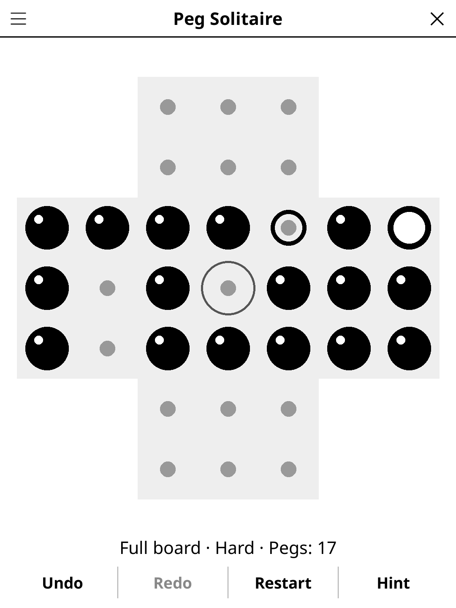

# pegsolitaire.koplugin

**Peg Solitaire** (FR « Solitaire à billes ») — the classic one-player board
game for [KOReader](https://github.com/koreader/koreader): jump the pegs over
each other until only one is left, in the goal hole.

## Screenshot

## Rules

1. Jump a peg over a neighbouring peg into the empty hole just behind it; the
   peg jumped over comes off the board.
2. Jumps follow the lines of holes: across and up/down on square boards (no
   diagonals), plus the third direction on triangular boards.
3. Finish with a single peg in the goal hole (grey ring). When no jump is
   left, the pegs remaining give the traditional rating: one in the goal hole
   *Genius*, one elsewhere *Excellent*, then *Very good*, *Good*, *Fair*,
   *Beginner*.

## Features

- **Five boards** — English (33 holes), French (37), triangles of 15 and 21
  holes, 5×5 square.
- **35 puzzles** — full boards from their solvable starting holes and classic
  figures (Cross, Plus, Fireplace, Pyramid, Up arrow, Diamond, Double cross,
  Heart, Star, Frame…), grouped by peg count: *Easy* up to 12, *Medium* up to
  24, *Hard* beyond. The English full board with the centre hole empty is the
  first game.
- **Progress** — "New game" opens the next puzzle you haven't solved on the
  board; the *Puzzle* menu lists them all (✓ when solved, else your best).
- **Daily Challenge** — the same puzzle for everyone today.
- **Hint** — two taps: the first marks the peg and rings its destination, the
  second plays it. A hint is always a jump that keeps the puzzle solvable
  *from where you are*, found by an on-device solver. If the position can no
  longer be solved, the hint says so and offers to take you back to the last
  position that can.
- **Honest about its limits** — the solver has a strict time budget for a
  slow e-reader. On a big board with many pegs it may not decide in time; it
  then says so (no guessing) and offers to think longer or to go back to the
  last position known to be solvable.
- **Warn if unsolvable** (menu, on by default) — a quick check after each
  jump; the status line says when there is no solution any more.
- **Show solution** — gives up the puzzle and steps through a solution.
- **Undo**, **Redo**, **Restart**, pegs counter, timer and auto-save.

## Controls

| Action | How |
|--------|-----|
| Pick up a peg | Tap it (rings mark the holes it can jump into) |
| Jump | Tap a ringed hole |
| Undo / Redo / Restart / Hint | Buttons under the board |
| New game, Daily Challenge, board, puzzle, warning, solution, rules | Title-bar menu |

## Why e-ink friendly?

Black marbles on a light grey board, no animation: a jump repaints the screen
once. The goal ring stays visible around a peg.

## The solver

`solver.lua` is a depth-first search with a memo of positions proved dead
(up to the board's symmetries), and *pagoda functions*: weights on the holes
such that no jump can raise the weighted peg count, so a position already
below the goal's weight is cut at once. The pagodas are found offline by
`tools/build_pagodas.lua` (cutting planes: a small LP per hard dead position
met in the search) and shipped in `pagodas_data.lua`. On the device every
search has a node budget; the memo is kept between questions, so asking
again goes further.

Measured with LuaJIT on a desktop, English board, centre finish: the full
board from the start solves in 1 100 nodes (2 ms). Of 1 000 random positions
1 to 24 jumps into that game, 97% are decided within the hint budget (250 000
nodes, 0.19 s on the desktop, a few seconds on a 2013 e-reader) and 92% within
the warning's (60 000 nodes); the rest get the honest "can't tell quickly".
The hardest of them needed 2.1 million nodes (1.5 s, 12 MB of memo). The
French full boards and the 5×5 square are harder to decide early on (85–90%
within the hint budget); the triangles always decide at once.

## Puzzles

`tools/build_puzzles.lua` reads `tools/puzzles_src.lua` (pictures of the
starting positions), checks the position class of every goal, solves every
puzzle without a budget and stores the solution in `puzzles_data.lua`; a
puzzle that can't be finished fails the build. Rebuild with
`tools/build_puzzles.sh` (puzzles, then pagodas).

## License

GPL-3.0
